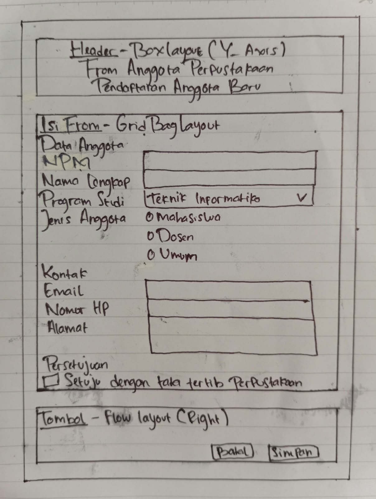
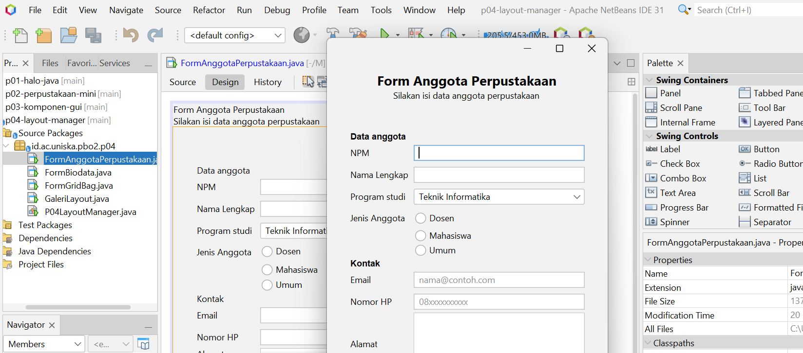
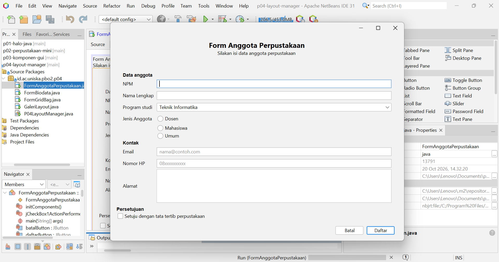
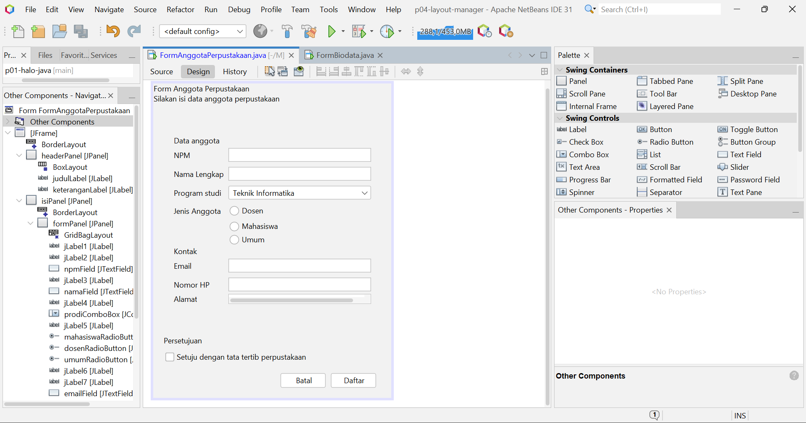

# Tugas PBO2 Pertemuan 4

## Jawaban Refleksi (Bagian G)

1\. Null Layout atau Absolute Layout sebaiknya dihindari karena posisi dan ukuran komponen harus diatur secara manual sehingga tampilan dapat berantakan ketika ukuran jendela berubah.

2\. FlowLayout menyusun komponen secara berurutan dan dapat memindahkannya ke baris berikutnya, sedangkan GridLayout menyusun komponen dalam baris dan kolom dengan ukuran yang sama.

3\. Weight X berfungsi mengatur pembagian ruang horizontal tambahan, sedangkan Fill menentukan apakah komponen mengisi ruang yang tersedia.

4\. formPanel diletakkan di posisi North agar form tetap berada di bagian atas, meskipun terdapat ruang kosong di bawahnya ketika jendela diperbesar.

5\. Prinsip desain yang diterapkan adalah konsistensi ukuran dan gaya komponen agar tampilan rapi, serta pengelompokan bagian Data Anggota, Kontak, dan Persetujuan agar form mudah dipahami.

## Foto Sketsa Form dan Tabel Rancangan 
### Sketsa

### - Tabel Rancangan
| Bagian     | Panel/Komponen | Layout               |
| ---------- | -------------- | -------------------- |
| Jendela    | `JFrame`       | `BorderLayout`       |
| Header     | `headerPanel`  | `BoxLayout (Y_AXIS)` |
| Isi form   | `isiPanel`     | `BorderLayout`       |
| Form isian | `formPanel`    | `GridBagLayout`      |
| Tombol     | `tombolPanel`  | `FlowLayout (RIGHT)` |

## Tangkapan Layar Hasil FormAnggotaPerpustakaan
### 1. Ukuran awal

### 2. Ukuran saat dilebarkan

## Tab Design FormAnggotaPerpustakaan (Jendela Navigator)

## Jawaban Eksperimen Praktium
### - Praktikum 2:
1\. Posisi tombol berubah menjadi di tengah panel. Pada initComponents(), nilai FlowLayout.LEFT berubah menjadi FlowLayout.CENTER.

2\. Terbentuk 5 baris karena terdapat 9 tombol dan 2 kolom. GridLayout otomatis menyesuaikan jumlah baris agar semua tombol tertampung.

3\. Lebar tombol menjadi lebih besar mengikuti ruang panel yang tersedia. Vertical Strut menambahkan jarak vertikal antartombol sehingga susunannya lebih rapi dan tidak terlalu rapat.

### - Praktikum 4:
1\. Pada Weight X = 0.0, isian tidak mendapat bagian dari ruang horizontal tambahan saat jendela dilebarkan. Bukan hanya ruang di sebelah kanan.

2\. Jika Direction pada formPanel diubah dari North menjadi Center, form akan berada di tengah isiPanel saat jendela ditinggikan. Sebaliknya, jika menggunakan North, form tetap berada di bagian atas meskipun terdapat ruang kosong di bawahnya.

3\. Setelah setMinimumSize(getSize()) dihapus, jendela dapat diperkecil hingga komponen form menjadi terlalu sempit. Text Field dan Text Area mengecil sehingga tampilan form kurang rapi, sedangkan tombol dapat tersusun ke bawah ketika lebar jendela terlalu kecil.  

## Saran dari Teman pada Tahap 4
Nama Teman: Luthfia Agustina (2410010202)
| No | Pemeriksaan | Ya atau Belum |
|:--------|:------|:------|
|1 | Label singkat, jelas, dan sejajar|Ya|
|2 | Isian dikelompokkan dengan judul bagian|Ya|
|3 | Placeholder dipakai untuk isian yang punya format|Ya|
|4 | Komponen sesuai jenis data|Ya|
|5 | Tombol utama menonjol dan berada di kanan bawah|Ya|
|6 | Jarak antar komponen konsisten|Ya|
|7 | Form tetap rapi saat jendela dilebarkan dan ditinggikan|Ya|
|8 | Tampilan dibuat dengan JFrame Form dan layout manager bukan Null Layout atau Absolute Layout|Ya|

Saran: Saran saya, saat jendela dilebarkan, jarak antar radio button mahasiswa, dosen, dan umum ikut melebar. sebaiknya dikumpulkan dalam satu sel dengan anchor west, lalu di beri jarak lewat insets.

### Deklarasi penggunaan AI
Saya menggunakan Ai (ChatGPT) untuk memahami instruksi modul yang kurang jelas dan membantu mengatasi kendala saat membuat Form Anggota Perpustakaan di NetBeans, seperti jarak label dan kolom isian yang terlalu lebar setelah menambahkan komponen checkbox.