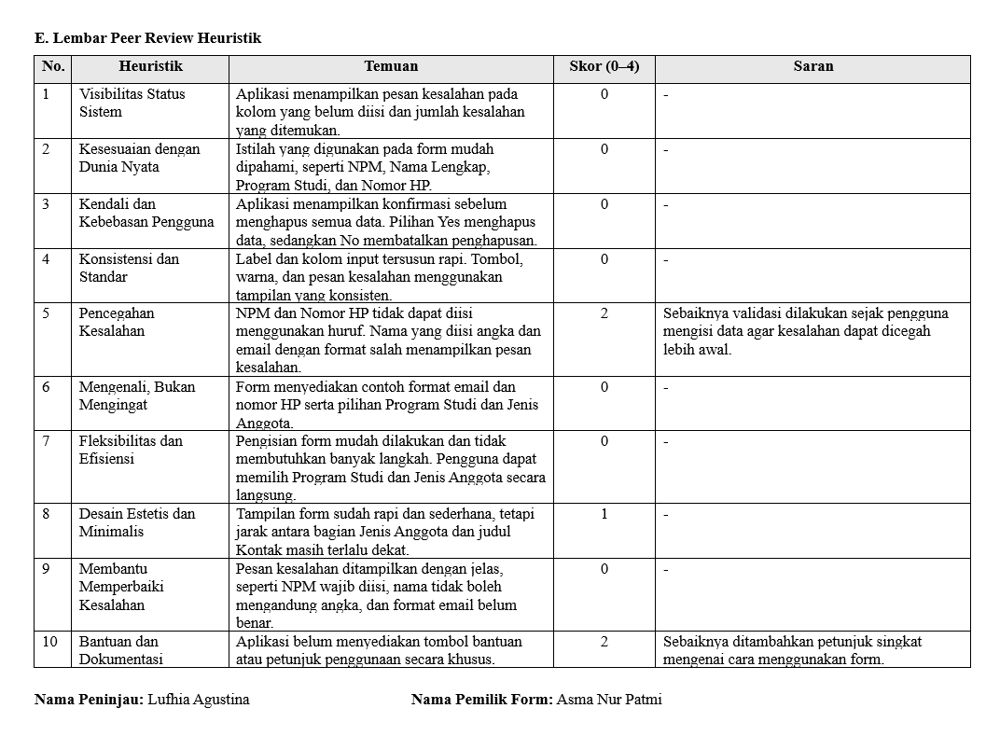
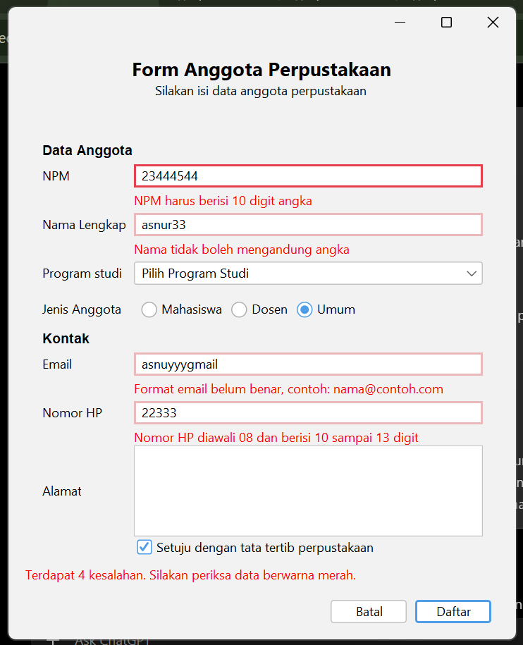
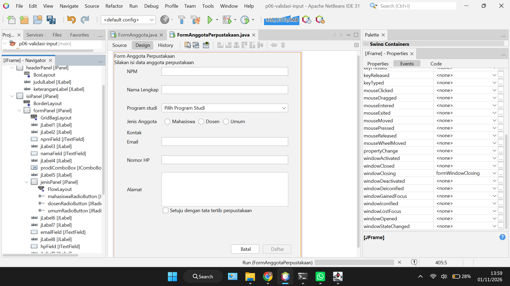

# Pertemuan PBO P06

## Foto atau Pindaian Lembar Peer Review

## Tabel Temuan Peer Review dan Perbaikan
| No. | Temuan dari Teman | Skor | Perbaikan yang Dilakukan | Commit |
|---|---|---:|---|---|
| 1 | Validasi sebaiknya dilakukan sejak pengguna mulai mengisi data agar kesalahan dapat diketahui lebih awal. | 2 | Menambahkan validasi langsung saat pengguna mengetik pada kolom NPM, nama, email, dan nomor HP. | `2ab9b33` |
| 2 | Jarak antara bagian Jenis Anggota dan judul Kontak masih terlalu dekat. | 1 | Menambahkan jarak pada judul Kontak agar tampilan form lebih rapi. | `2ab9b33` |
| 3 | Aplikasi belum menyediakan bantuan atau petunjuk penggunaan secara khusus. | 2 | Menambahkan tombol Petunjuk yang menampilkan panduan penggunaan formulir. | `2ab9b33` |

## Tangkapan layar (screenshot) formAnggota dengan pesan kesalahan

## Tangkapan layar jendela Navigator yang memperlihatkan label pesan

## E. Jawaban Eksperimen Praktikum 4
1\. Saat mengetik huruf pada isian NPM, huruf tersebut tidak muncul karena isian NPM hanya bisa diisi angka. Hal ini disebabkan oleh perintah `evt.consume();` yang berfungsi membatalkan huruf yang diketik selain angka.

2\. Setelah mengisi email dengan `siti@` lalu menekan Tab, pesan kesalahan langsung muncul karena format email yang dimasukkan belum benar.

3\. Saat isian Nama dilewati tanpa mengetik apa pun, tidak ada pesan kesalahan yang muncul. Hal ini karena program hanya memeriksa nama jika isian sudah diisi. Kalau masih kosong, pemeriksaan baru dilakukan saat tombol Daftar diklik.

4\. Saat persetujuan dicentang lalu tombol Daftar diklik dalam keadaan form kosong, fokus langsung berpindah ke isian NPM karena NPM merupakan isian pertama yang belum benar.

5\. Saat menekan tombol Alt bersama huruf N, fokus berpindah ke isian Nama. Hal ini karena huruf N digunakan sebagai shortcut pada label Nama dengan pengaturan `displayedMnemonic` dan `labelFor`.

6\. Iya, data yang sudah diisi tetap ada karena saat memilih No, penghapusan dibatalkan. Jadi, data yang sebelumnya dimasukkan tidak terhapus dan masih tampil di form.

## Deklarasi Penggunaan AI
Saya menggunakan AI (ChatGPT) untuk membantu mengatasi kendala saat membuat Form Anggota Perpustakaan di NetBeans, terutama dalam penerapan event handling dan pengaturan komponen form.